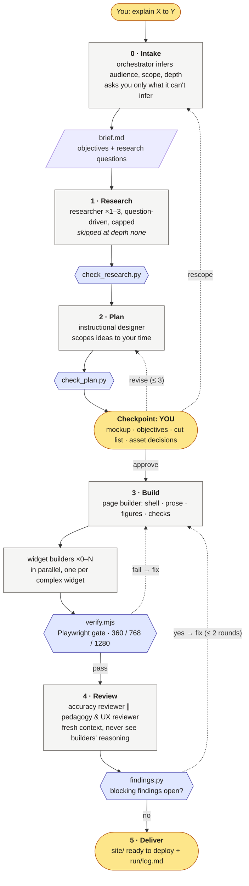
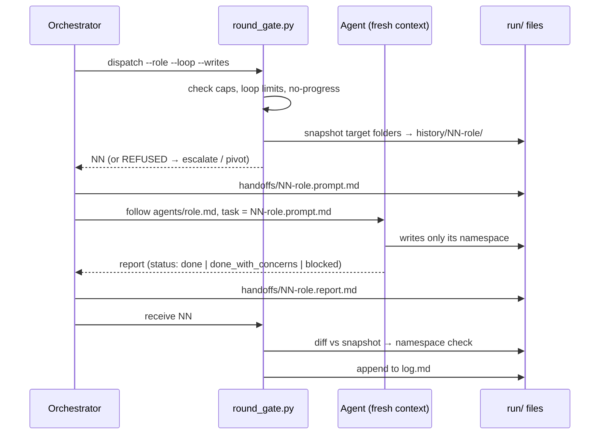

# Didactician

A Claude Code skill that turns "explain X to Y" into a **deployable static explainer**: a long-form article, a scrollytelling piece, a full-page explorable widget, or a mix of these. Agents pick the form to fit the topic. A governed multi-agent pipeline produces it: research is bounded, you approve a plan before anything is built, a deterministic browser gate checks the result, and reviewers that never saw the authors' reasoning judge it.

```
/didactician explain how CRDTs converge, for Hacker News readers, ~10 minutes
```

You get `explainers/<slug>/site/`, a folder you can drop on GitHub Pages, Cloudflare Pages or any static host. Next to it is `explainers/<slug>/run/`, a human-readable record of everything that happened.

---

## How it flows



**Reading the diagram:**

- **Rounded boxes** are where you're involved.
- **Hexagons** are deterministic script checks. They can fail a stage, and no agent can talk its way past them.
- **Grey boxes** are agents. Each runs in a fresh context, gets a self-contained handoff file, and writes only to its own folder.
- **Dotted arrows** are the loops. Each is capped, and a script stops it if it makes no progress.

If your viewer doesn't render Mermaid, the same diagrams are in [`docs/flow.png`](docs/flow.png) and [`docs/dispatch.png`](docs/dispatch.png). Here is the flow in short:

```
you ─► INTAKE ─► RESEARCH ─► PLAN + MOCKUP ─► ◆ YOU APPROVE ◆ ─► BUILD ─► GATE ─► REVIEW ─► site/
            (bounded)    (scoped in ideas)                        (page,    (Playwright) (accuracy ∥
                                                                  widgets)               pedagogy/UX)
```

### What happens inside every agent hand-off

The orchestrator (your main Claude session) never writes content itself. Every piece of work it hands out follows the same bracket. That bracket keeps the run auditable and bounded:



---

## What you'll be asked, and when

| When | What | Why it's you |
|---|---|---|
| **Intake** (only if it can't infer) | Audience, time budget, standalone vs. part of a course, research depth | They change everything downstream |
| **Checkpoint** (always) | Approve / revise / rescope the plan. The mockup opens in your browser. Also: decisions on any third-party media whose licence isn't clearly fine for your use | A wrong plan is the most expensive error. Media clearance depends on use (commercial vs. blog) |
| **Deltas** (rare) | A post-approval change to objectives, segments, shape or assets | You approved a plan; changes to it come back to you |
| **Escalations** (rare) | A cap hit, a false premise, an infeasible scope, a dispute between a builder and a reviewer | Only the source of a constraint can relax it |

### Research depth (you choose per run)

| Depth | Use for | What it costs |
|---|---|---|
| `none` | Well-trodden topics | No researcher. The accuracy reviewer web-checks core claims instead |
| `light` | Default for ≤ 10 min | 1 researcher, ≤ 12 claims, ≤ 8 sources |
| `standard` | Default for longer; niche, recent, or codebase topics | 1 researcher, ≤ 25 claims, ≤ 15 sources |
| `deep` | Contested, technical, high-stakes | 2–3 researchers, ≤ 40 claims, ≤ 25 sources |

**Research can't bloat the piece.** Researchers answer questions derived from the objectives, not "the topic". Each claim is a single assertion tied to an objective, and anything off-topic goes to a parking lot the designer only skims. The designer scopes the plan by how many ideas fit your time, not by word counts, so the prose is written at whatever length clarity needs. Everything researched but left out appears in the **cut list** at the checkpoint, so you can pull items back in. The cut list also ranks what to cut first if the built page runs long, and you choose.

---

## What's enforced vs. what's judged

**Enforced by scripts.** These fail the stage, and only you can relax them:

| | Invariant |
|---|---|
| I1 | No horizontal overflow at 360px (unless you waive mobile) |
| I2 | Static only: no runtime calls to undeclared origins (CDNs are fine) |
| I3 | Third-party media is cleared and visibly attributed |
| I4 | One-shot animations have a replay control |
| I6 | Carousels don't reflow the page |
| I7 | SVG arrowheads resolve and aren't clipped |
| I8 | Each agent writes only in its own folder (detected after the fact) |

The gate also fails on: console errors, broken resources, root-absolute URLs (the site must work under any sub-path), and leftover placeholders. It **warns** on SVG text too small to read on a phone.

**Judged by agents.** These are deliberately *not* rules:

- whether to use scrollytelling, an article or a full-page widget;
- whether to include comprehension checks or a ToC;
- which libraries to use.

The designer makes these calls with a stated reason, and the reviewers judge whether the call fits the brief. Preferences, in rank order: **accuracy > instructional effectiveness > UX clarity > low cost > polish.**

---

## The audit trail

Everything is a file. To see what happened and why, start at `run/log.md`. Each entry links what it refers to.

```
explainers/<slug>/
├── site/                         ← deploy this folder
└── run/
    ├── log.md                    ← start here: timeline with links
    ├── brief.md                  ← the root spec every agent points to
    ├── decisions.md              ← every answer you gave, verbatim
    ├── research/  plan/          ← the agents' work products
    ├── handoffs/NN-role.prompt.md / .report.md   ← exactly what each agent was told and said
    ├── history/NN-role/          ← snapshot before each agent touched anything
    ├── gate/  screenshots/       ← gate results and renders at each width
    └── review/round-N/findings.md
```

A sample of `log.md`:

```markdown
### 2026-10-19T12:19:33-04:00 · orchestrator · dispatch
Dispatch 02 → **instructional-designer** (plan), loop checkpoint round 1/4. May write: `run/plan`.
Usage: 2/12 dispatches, 0/45 agent-min.
- [handoffs/02-instructional-designer.prompt.md](handoffs/02-instructional-designer.prompt.md)

### 2026-10-19T12:20:23-04:00 · orchestrator · findings
Round 2 ingested: 3 finding(s) touched; open: 0 blocking, 1 should, 1 nit.
- [review/round-2/findings.md](review/round-2/findings.md)
```

To see how an artifact changed, diff the snapshot against the current file. For example, `diff -r run/history/05-page-builder/site site` shows what dispatch 05's revision did.

---

## Setup

1. **Install the skill** into a project: copy or symlink this folder to `<project>/.claude/skills/didactician/`.
2. **Requirements:** Node ≥ 20 and Python ≥ 3.8. On first use the skill runs `scripts/preflight.sh`, which installs a pinned Playwright (1.63.0) and Chromium into `~/.cache/didactician/`. It doesn't touch your project's `node_modules`. Override the location with `DIDACTICIAN_CACHE`.
3. **Use it:** `/didactician <what to explain, for whom, how long>`, or just ask Claude to explain something as an explorable or explainer. Mention deployment instructions in the request if you want it deployed; otherwise it stops at a ready folder.
4. **Preview:** `npx serve explainers/<slug>/site`, or open `index.html` directly.

### Self-test

```bash
bash tests/run.sh      # gate on bad/good/kit fixtures + round_gate behaviour; expect "failed 0"
```

---

## What's in this folder

| Path | What | Who reads it |
|---|---|---|
| `SKILL.md` | The orchestrator's workflow | Your main Claude session |
| `agents/*.md` | One contract per role: researcher, instructional-designer, page-builder, widget-builder, accuracy-reviewer, pedagogy-ux-reviewer | Each subagent |
| `references/` | Learning science (`learning-science-patterns.md`, `cognitive-design-patterns.md`), `ux-ui.md`, `graphics.md`, `widgets.md`, `sourcing.md` | Designer, builders, reviewers |
| `templates/` | Formats for the brief, plan, handoffs, reports, reviews, decisions, and the mockup skeleton | Everyone. The scripts parse these |
| `kit/` | Optional page runtime: design tokens (8px grid, light/dark), components, ToC rail, SVG arrows, replay, carousel, widget helper | Builders copy it into `site/assets/` |
| `scripts/` | `round_gate.py`, `verify.mjs`, `probe.mjs`, `check_*.py`, `findings.py`, `init_run.py`, `log.py`, `preflight.sh` | Orchestrator and agents |
| `DESIGN.md` | Why it's built this way: failure-mode review, constraint ledger, and the **assumption ledger** of scaffolding to test removing as models improve | Maintainers |

## Known limits

- **Privilege boundaries are prompt-level.** A drop-in skill can't restrict subagents' tools. Out-of-namespace writes are *detected* (and block the next dispatch until acknowledged), not prevented. See DESIGN.md "Soft vs. enforced".
- **Caps hold only while the orchestrator follows SKILL.md.** A skipped gate call shows up in the log as a dispatch without an entry.
- **The gate checks what's checkable.** It can tell an arrowhead is clipped, not that it points at the wrong node. That's what the screenshots and the reviewers are for.
- **Not yet battle-tested** end to end with real agents. The first practice runs will tune the prompts.
